# mention-bot

Your own assistant for Discord and GitHub. It **DMs you every mention with a reply drafted by
your local Claude Code login**, and posts the reply only after you press **Send**. A **task
board** in your browser holds those mentions and the tasks you hand to Claude Code, which runs
them in your project folders and leaves the work as local changes for you to check.

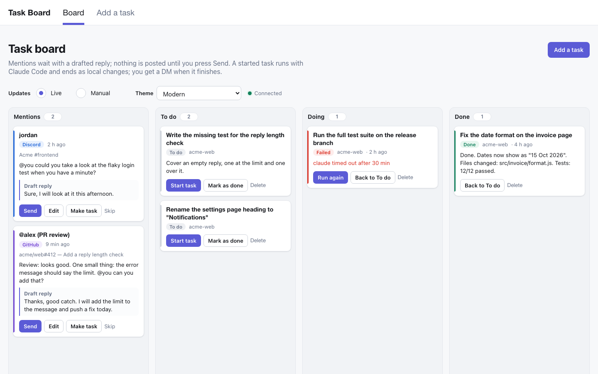

- [Setup](#setup)
- [Using it](#using-it): [mentions](#replying-to-mentions) · [the task board](#the-task-board) ·
  [running a task](#running-a-task) · [live or manual updates](#live-or-manual-updates) ·
  [themes](#themes) · [on a phone](#on-a-phone)
- [Design check posts](#design-check-posts)
- [Settings](#settings) · [Safety](#safety) · [Project layout](#project-layout) · [Limits](#limits)

## Setup

1. **Discord bot**
   - https://discord.com/developers/applications > New Application > Bot.
   - Turn on **Message Content Intent** (Bot page, Privileged Gateway Intents).
   - Copy the bot token into `.env` as `DISCORD_TOKEN`.
   - Invite it: OAuth2 > URL Generator > scope `bot`, permissions View Channels, Send
     Messages, Read Message History. Open the URL and add it to each server you want watched.
2. **Your Discord user ID** into `DISCORD_OWNER_ID` (Settings > Advanced > Developer Mode,
   then right-click yourself > Copy User ID). You must share a server with the bot and allow
   DMs from server members.
3. **GitHub token** (optional) into `GITHUB_TOKEN`: a classic personal access token with
   `notifications`, plus `repo` for private repos.
4. **Claude Code** must be installed and logged in on this machine (`claude`).
5. **Task board** (optional): `BOARD_DIRS` = the folders a task may run in, comma-separated.

```bash
cp .env.example .env
npm install
npm start
```

Then open **http://127.0.0.1:4747** for the task board.

## Using it

### Replying to mentions

When someone @mentions you on Discord (people **and** other bots, such as a teammate's
Claude) or on GitHub (comments, the opening post, and PR review texts), the bot:

1. drafts a reply with Claude (it only sees the message and a few earlier ones, with every
   tool switched off, so a message can't make it do anything);
2. **DMs you** the mention and the draft with **Send**, **Edit** and **Skip**;
3. puts the same mention in the **Mentions** column of the task board.

Decide in either place; the other one updates (the DM loses its buttons, the card leaves the
column). **Nothing is posted until you press Send.** A Discord reply goes as a reply to the
message; a GitHub reply as a normal comment under your account.

On the board, **Edit** opens the reply page: the full message, earlier messages, and the draft
in a box with a character counter. **Send reply**, **Save draft**, **Make it a task** (turns
the mention into a To do card with the message and link) or **Skip, don't reply**.

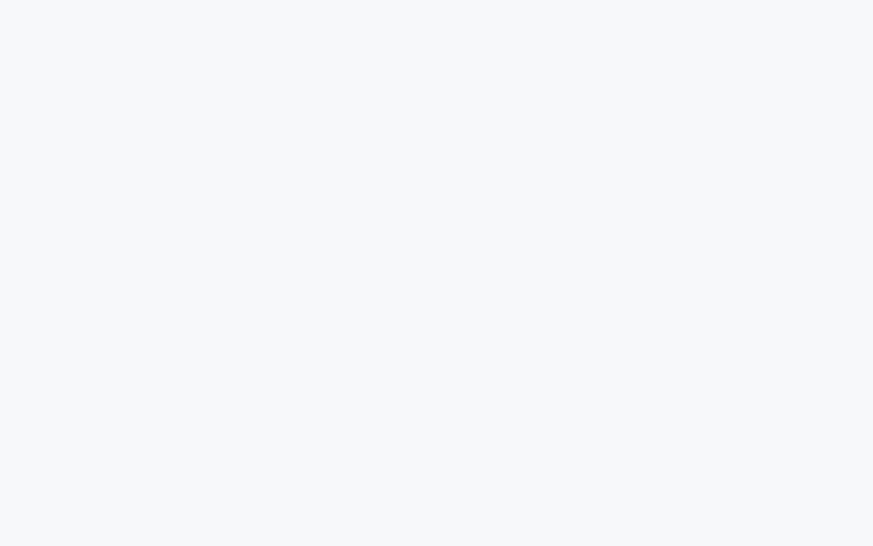

| The reply page |
| --- |
| 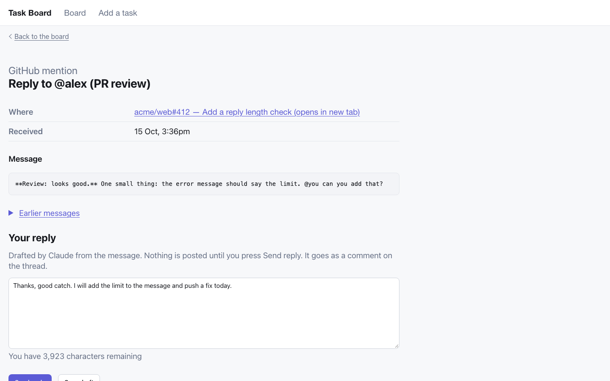 |

If the bot was off when a mention came in, it **catches up** on its next start: it looks back
`CATCHUP_HOURS` (default 24) on Discord and GitHub. Mentions you already handled never come
back.

### The task board

Four columns, each a panel that scrolls on its own:

| Column | What's in it |
| --- | --- |
| **Mentions** | Mentions waiting for your reply (purple strip = GitHub, blue = Discord) |
| **To do** | Tasks you've added but not started |
| **Doing** | The task Claude is working on (yellow), tasks waiting their turn (blue), and failed runs (red) |
| **Done** | Finished tasks (green), with Claude's summary |

Each card shows the title, a status tag, the folder and the time; text is cut to three lines,
and the title opens the full page. Success messages ("Reply sent", "Task started") fade after
3 seconds.

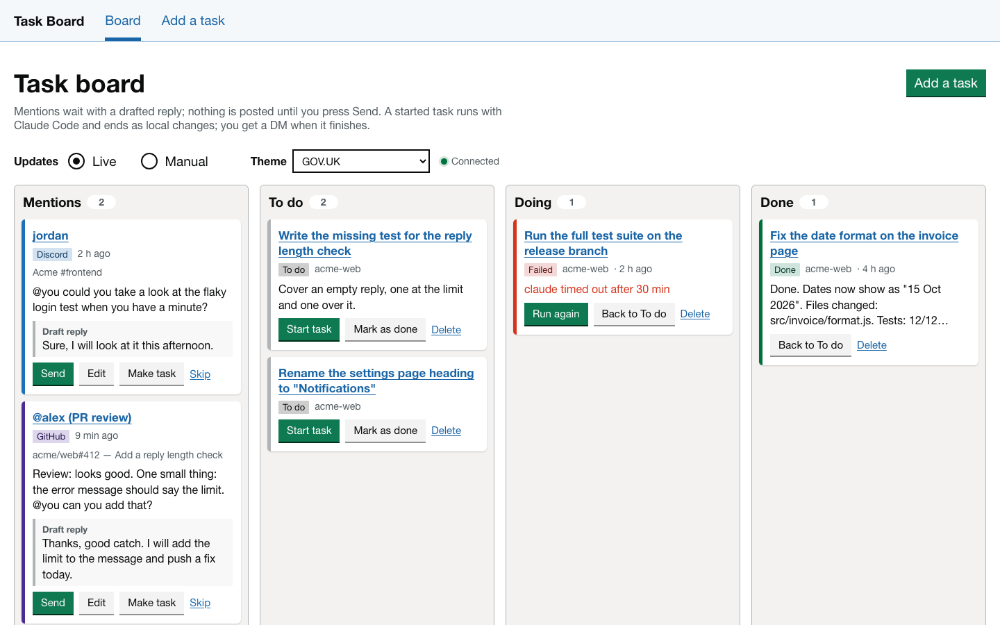

### Running a task

1. **Add a task**: what Claude should do, optional details (the PR, the files, what done looks
   like: it runs on its own, so say everything it needs) and the folder it runs in.
2. **Add and start**, or **Add to To do** and press **Start task** later.
3. The card moves to **Doing** and Claude works on it. One task runs at a time; others wait.
4. When it finishes, the card moves to **Done** with Claude's summary, and **you get a DM**. A
   failed run stays in Doing with the reason and a **Run again** button.

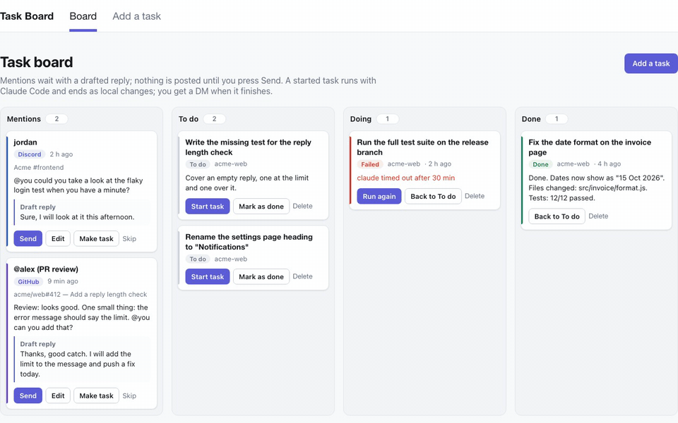

| Add a task | A finished task |
| --- | --- |
| 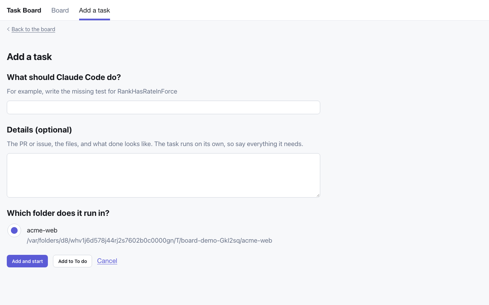 | 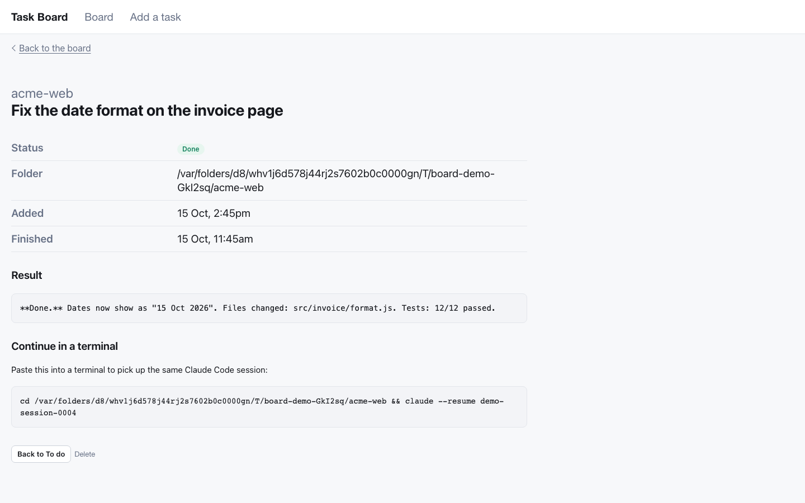 |

On a card or the task page: **Start task** / **Run again**, **Back to To do**, **Mark as done**
(without running it) and **Delete** (asks first; files the task changed stay as they are).

**Continue in a terminal:** every run keeps its Claude session. The task page shows the command
(`cd <folder> && claude --resume <id>`) to pick it up where it stopped.

**What a task may do:** read and edit files, `git add` / `git commit`, read-only `git` and `gh`,
and run `phpunit` / `vitest`. **Blocked:** `git push`, `gh api`, creating, merging or commenting
on PRs and issues, `curl`, `rm`. A task always ends as local changes for you to check and push.

| Deleting asks first |
| --- |
| 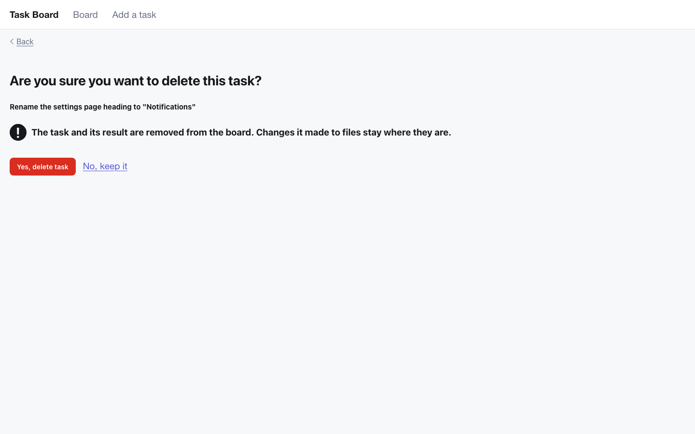 |

### Live or manual updates

Above the columns, **Updates** has two modes (remembered in your browser):

- **Live** (default): the board changes by itself the moment a mention arrives or a task moves,
  redrawing only the column that changed. The dot shows **Connected**, or **Reconnecting…**
  while the bot restarts.
- **Manual**: the board stays still. New activity shows **New updates** and a **Refresh**
  button; nothing changes until you press it.

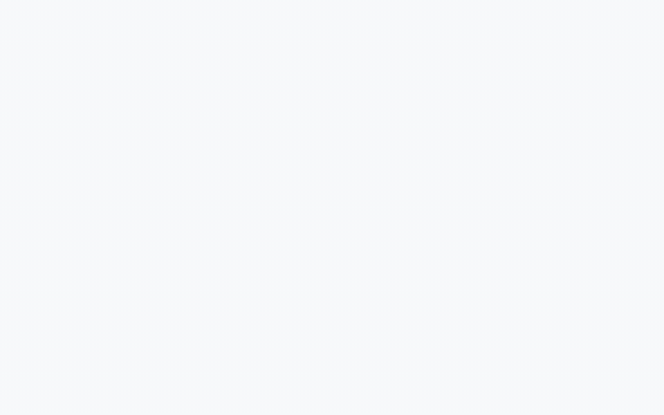

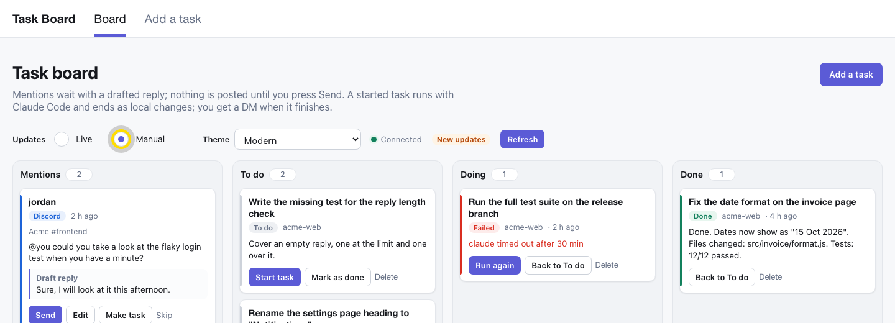

### Themes

Pick a **Theme** above the columns; it applies to every page and is remembered in your browser.

| GOV.UK (default) | Modern | Modern dark |
| --- | --- | --- |
|  |  | 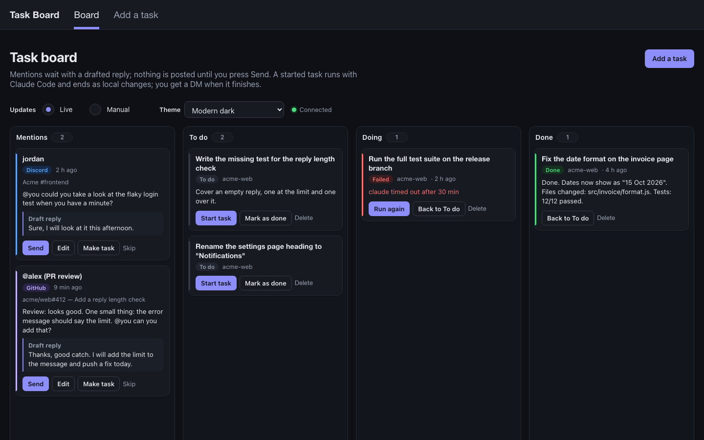 |

**Auto** follows your Mac's light or dark setting. GOV.UK is the most accessible (high
contrast, large buttons); Modern is denser. The pages are built with
[GOV.UK Frontend](https://frontend.design-system.service.gov.uk/) components, without GOV.UK's
crown, name or font (this is not a government service).

### On a phone

The columns stack; each one still scrolls on its own, and the buttons stay small.

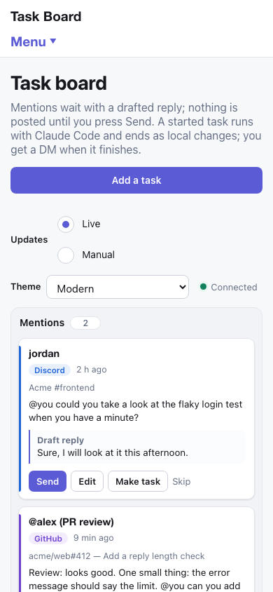

### Keyboard and no JavaScript

Every page works without JavaScript (you reload to see changes). With the keyboard, Tab into a
column and scroll it with the arrow keys; it shows a focus frame only for keyboard use.

## Design check posts

Posts a design preview as one forum post, then puts its link in the team channel. Set the
three `DESIGN_CHECK_*` values in `.env` first.

```bash
npm run design-check -- path/to/PREVIEW.md          # dry run: prints every message, posts nothing
npm run design-check -- path/to/PREVIEW.md --post   # posts it
```

The preview file:

- `# <EPIC/story> · <screen or feature>` is the forum post title (100 characters at most).
- `Line: <story, what it is in a few words>` is the text for the team channel; the link is
  added after it. Without it, the title is used.
- Each `## ` section becomes one message in the post. Text above the first section goes with it.
- An image or video named in a section (`1-list.png`) is attached to that section's message
  when the file sits in the same folder as the preview.
- `@D` becomes a real mention of `DESIGN_CHECK_MENTION_ID`.

The post gets the "Waiting review" tag. A title is posted only once; a new version goes inside
the existing post by hand (`--again` forces a new post).

## Settings

In `.env` (see `.env.example`):

| Setting | What it does |
| --- | --- |
| `DISCORD_TOKEN`, `DISCORD_OWNER_ID` | The bot's token and your Discord user ID (required) |
| `GITHUB_TOKEN` | Turns on GitHub mentions; empty = off |
| `GITHUB_POLL_SECONDS` | Seconds between GitHub checks (default 60; GitHub may ask for longer) |
| `REPLY_STYLE` | How drafted replies should sound |
| `CLAUDE_MODEL` | Model alias for `claude --model` (empty = your default) |
| `CATCHUP_HOURS` | How far back a start looks for missed mentions (default 24) |
| `BOARD_DIRS` | Folders a task may run in, comma-separated; empty = no task board |
| `BOARD_PORT` | The board's port (default 4747) |
| `BOARD_TIMEOUT_MINUTES` | A task run is stopped after this long (default 30) |
| `DESIGN_CHECK_FORUM_ID`, `DESIGN_CHECK_LINK_CHANNEL_ID`, `DESIGN_CHECK_MENTION_ID` | For `npm run design-check` |

What the bot keeps on disk (all git-ignored): `state.json` (mentions already handled),
`mentions.json` (mentions and their drafts), `board.json` (tasks).

## Safety

- **Nothing is posted without your Send**, in the DM or on the board.
- Drafts run with every Claude tool off, in an empty folder: a mention can't make Claude read
  or change anything.
- Tasks can't push, comment, merge, call `gh api`, `curl` or `rm` (see
  [Running a task](#running-a-task)).
- The board only answers on this Mac (`127.0.0.1`), and every form carries a key written into
  the page and must come from the same origin, so another website can't start a task. The key
  changes when the bot restarts: a form from an older page shows "The page has expired".
- Each draft and task run uses your Claude subscription.

## Project layout

```
src/
  index.js              start-up: checks .env, starts Discord, GitHub and the board
  config.js             every setting from .env, read in one place
  lib/                  small shared helpers (text, change events)
  store/                what is saved to disk: seen.js (state.json),
                        mentions.js (mentions.json), tasks.js (board.json)
  claude/               cli.js (runs `claude -p`), drafts.js (reply drafts),
                        tasks.js (board tasks, with the allowed/blocked tool lists)
  discord/              client.js, mentions.js (reading + catch-up),
                        approvals.js (the DM with Send / Edit / Skip)
  github/               mentions.js (polling, comments and PR reviews)
  board/                server.js (wiring), security.js, filters.js, view-models.js,
                        runner.js (task queue), routes/ (live, tasks, mentions)
  tools/design-check.js `npm run design-check`
views/                  layout.njk, pages/, partials/ (Nunjucks + GOV.UK macros)
public/                 css/ (board.css = GOV.UK look, themes.css = Modern),
                        js/ (main, live, notices, theme, storage), favicon.svg
scripts/docs/           makes the screenshots and recordings in docs/media/
```

```bash
npm run check          # syntax of every JS file
npm run format         # Prettier (format:check to only check)
npm run docs:media     # remake docs/media/ from a demo board (needs Chrome and ffmpeg)
```

`npm run docs:media` starts a demo board on port 4790 with made-up mentions and tasks and a
stand-in for `claude` that answers in 3 seconds, so it never touches your real data or uses
Claude. Run it after changing the UI to refresh the README's images.

## Limits

- The bot only sees Discord servers it was invited to, and no DMs.
- GitHub inline review comments and discussions are not handled.
- One task runs at a time.
